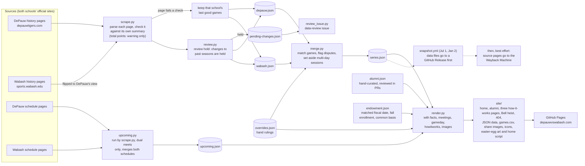
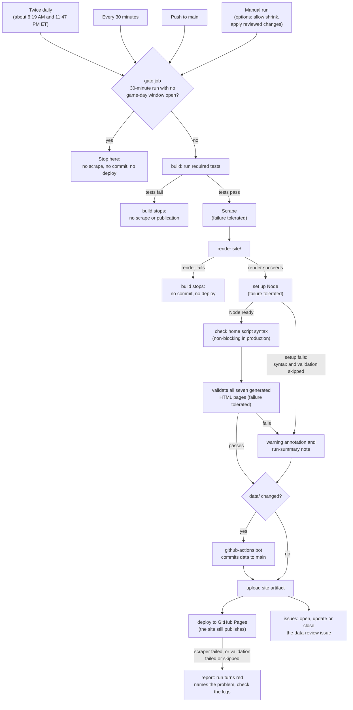
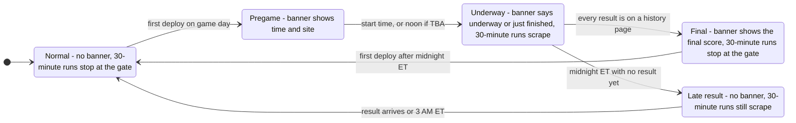

# DePauw vs. Wabash

All-time head-to-head records between DePauw University and Wabash College in every men's sport where the two schools play each other head to head. Each sport's record combines both schools' own history pages, so it is the most complete history either school has:

| Sport | DePauw's page | Wabash's page |
|---|---|---|
| Football | [depauwtigers.com](https://depauwtigers.com/sports/football/opponent-history/wabash/215) | [sports.wabash.edu](https://sports.wabash.edu/sports/football/opponent-history/depauw-university/4) |
| Men's basketball | [depauwtigers.com](https://depauwtigers.com/sports/mens-basketball/opponent-history/wabash/215) | [sports.wabash.edu](https://sports.wabash.edu/sports/mens-basketball/opponent-history/depauw-university/4) |
| Baseball | [depauwtigers.com](https://depauwtigers.com/sports/baseball/opponent-history/wabash/215) | [sports.wabash.edu](https://sports.wabash.edu/sports/baseball/opponent-history/depauw-university/4) |
| Men's soccer | [depauwtigers.com](https://depauwtigers.com/sports/mens-soccer/opponent-history/wabash/215) | [sports.wabash.edu](https://sports.wabash.edu/sports/mens-soccer/opponent-history/depauw-university/4) |
| Men's lacrosse | [depauwtigers.com](https://depauwtigers.com/sports/mens-lacrosse/opponent-history/wabash/215) | [sports.wabash.edu](https://sports.wabash.edu/sports/mens-lacrosse/opponent-history/depauw-university/4) |
| Men's tennis | [depauwtigers.com](https://depauwtigers.com/sports/mens-tennis/opponent-history/wabash/215) | [sports.wabash.edu](https://sports.wabash.edu/sports/tennis/opponent-history/depauw-university/4) |
| Men's swimming and diving (dual meets only) | [depauwtigers.com](https://depauwtigers.com/sports/mens-swimming-and-diving/opponent-history/wabash/215) | [sports.wabash.edu](https://sports.wabash.edu/sports/swimming-and-diving/opponent-history/depauw-university/4) |

Cross country, track and field, and golf are left out because they are multi-team events rather than head-to-head games. Swimming and diving counts dual meets only; invitationals and championships are left out (see "Swimming and diving: dual meets only" below).

**Live site: https://depauwvswabash.com/**

The site has two halves, joined by a navigation bar at the top of every page (**Athletics** | **Alumni**). The bar marks the half you are in; the how-it-works landing page, Bell-heist page and 404 page serve both halves and mark neither.

| Address | What it is |
|---|---|
| `/` | **Athletics.** The head-to-head records: totals, a card per sport, next meeting, game-day banner, Monon Bell block, data downloads |
| `/alumni/` | **Alumni and endowment.** Named graduates in ten award and public-service categories and endowment per student, with a source for every entry |
| `/how-it-works/` | A short landing page with a link to each of the two explanations below (the address was shared before there were two) |
| `/how-it-works/athletics/` | "How the athletics numbers work": sources, what is counted, how the two schools' records are combined, disputes, rulings, update times |
| `/how-it-works/alumni/` | "How the alumni numbers work": who counts, how names were sourced, the endowment basis, enrollment, rounding, the "about even" rule |
| `/bell-heist/` | A public, unindexed fictional Bell mission page, linked from the Monon Bell block |
| any missing address | `404.html`: two back links to the halves, root-relative links (GitHub Pages serves it at any depth), not indexed |

The site also publishes `data/series.json`, `data/alumni.json`, `data/endowment.json` and `games.csv` (the downloads linked in the footers), `sitemap.xml`, `robots.txt` and `site.webmanifest`.

Unofficial fan site, not affiliated with DePauw University or Wabash College. Only men's head-to-head competition is compared: Wabash is an all-male college, and multi-team events (cross country, track and field, golf, and swimming invitationals and championships) aren't head-to-head.

## What the site shows

- **All head-to-head sports** (the combined totals) and a card per sport: record, current streak, records since, total points/goals/runs, most recent game, and every game (newest first, with box-score links). Tennis counts matches and swimming and diving counts meets, rather than games; swimming scores can end in .5 and are shown as the schools list them.
- **Series summary.** One sentence under the all-sports totals says who leads which sports, written from the merged records (for example "Wabash leads football and baseball, including the Monon Bell era; DePauw leads basketball, soccer, lacrosse, tennis, and swimming and diving."). Every generated list of three or more items uses a serial comma (`render.join_and`). A sport is led by whoever has more wins; an even sport is listed on its own ("Soccer is even."). Sports keep the order in `sources.json`. The Monon Bell era is named whenever the football card has one, worded to fit whether its leader is also the all-time football leader. It is never hardcoded, so it changes by itself as results come in.
- **Both schools' records, merged.** Each card says where its record comes from ("Combined from DePauw and Wabash records: 141 games listed by both, 173 by Wabash only, 0 by DePauw only, 2 disputed", or "DePauw and Wabash records agree"). In the game list, a game only one school lists is marked "Wabash record only" or "DePauw record only". When the schools disagree on a score or winner, DePauw's version is the one counted and the game shows both, each labelled with whose record it is and in DePauw-Wabash order ("DePauw's record (DePauw-Wabash): 12-5 · Wabash's record (DePauw-Wabash): 11-5"). Games with no usable date (Wabash's oldest games sit on placeholder dates, and a date in a month the sport is not played in is treated the same way) show their season or year and "date not recorded", are listed first within their season, and never count as the "most recent" game. The 1954 basketball tie is footnoted because both schools list it.
- **Last checked.** The footer shows when the data last changed and when the scraper last reached the source pages, both in Eastern time, so you can tell the scheduled job is still running.
- **Next meeting.** The soonest upcoming game across all sports sits near the top, and each card shows its sport's next meeting (time or "TBA", postponed games marked, "Result pending" when a played game is not on the history page yet). Both schools' schedule pages are read; a game only Wabash's schedule lists is shown and says so. Several games on one date (a doubleheader) show as one meeting with every start time ("Doubleheader · 12:00 PM and 3:30 PM"; a game without a time says TBA). In the off-season there is simply nothing to show.
- **Game day.** On a day DePauw plays Wabash in any sport, a banner at the very top says so: "Game day: Football vs. Wabash today, 1:07 PM · Scheumann Stadium, Muncie, Ind." until the start, "... is underway or just finished" after it, and "Final: DePauw 41, Wabash 20" (winner first, linking to the sport's card, with who holds the Monon Bell for football) once the result is in. Two sports on one day share one banner. The link preview card gets a small "Game day" or "Final" label while the banner shows. The banner remains plain HTML written at each deploy and is gone at the first deploy after game day; the separate title entrance is the only JavaScript behavior.
- **Monon Bell.** The football card has a Monon Bell block: the record in games from the 1932 season on, who holds the Bell and since when (a tie leaves the Bell where it was, and the run says how many wins and ties it holds), and a short history with a link to [Wikipedia](https://en.wikipedia.org/wiki/Monon_Bell).
- **Small rivalry jokes.** A Bell icon opens the public unindexed `/bell-heist/` story, which labels itself fictional and links back to the real Bell holder. Each nonempty game history ends with a joke inside its closed disclosure. The shared footer has one impartiality disclosure and a source confession kept in an HTML comment. The alumni page has a separate admissions disclosure. Three decorative paw prints lead to a native tiger disclosure. These native links and disclosures work without JavaScript.
- **Secret Tiger entrance.** The home-page title becomes a button only after its deferred same-origin script initializes. Five activations announce “Your education has been verified.” once; reloading resets it. Other pages do not load scripts. Reduced-motion users get the same message without animation.
- **Fun facts** on each card, calculated from the games: biggest win and longest win streak for each school (a record several games share reads like "DePauw 9, Wabash 0 · by 9 matches (36 times, most recently Apr 24, 2026)"), one-score games (8 points in football, 3 in basketball, 1 run, goal or match elsewhere; "close meets" of 10 points or fewer in swimming), the highest-scoring game or meet (meets with no recorded score are left out of these), and overtime or extra-inning games. Sports that meet more than once a year (at least one season in five with two or more games) also get a season-by-season list. A fact that makes no sense for a sport is left out; ties never count as wins.
- **Direct links.** Each card has an id from its key in `sources.json` (`#football`, `#mens-basketball`, ...), plus `#monon-bell`, `#next-meeting` and `#game-day`, and each heading is itself the link to its section.
- **Download the data.** `data/series.json` (the merged data file as-is) and `games.csv` (one row per game: sport, date, season, location, site, DePauw score, Wabash score, result, note, box score link, plus which record it comes from, whether its date is recorded, whether the schools disagree on the score or the date, and Wabash's date and both schools' scores, in DePauw-Wabash order, when they differ) are published with the site and linked in the footer.
- **Report a data error.** Each card and the footer link to a GitHub issue form (`.github/ISSUE_TEMPLATE/data-correction.yml`) asking for the sport, game date, which school's record looks wrong (DePauw's, Wabash's, both, not sure), what is wrong and a link to the correct result. The issues are public, so the form asks for nothing personal.
- **How the numbers work.** Two plain-language pages for fans, and a short landing page that keeps the first address working. `/how-it-works/` is the landing page (one line and a link for each page, no JavaScript redirect). `/how-it-works/athletics/` is the original page (`scraper/howitworks.py`, built by `render.py`): where the data comes from, what is counted, how the two schools' records are combined, disputed games, the hand-made rulings, how often the site updates, how to report a mistake, and a link back here. Every number on it (games, disputed games, games with no recorded date, games one school lists, rulings, the match window, the placeholder dates, the game-day interval) is read from the data files or from the constants in `merge.py` and `gameday.py`, never typed in. It has the home page's header, footer, stylesheet, shared base security policy (the home page adds its script exception), light and dark mode, canonical URL, preview card and share image, is in `sitemap.xml`, and is linked from the athletics footers. `/how-it-works/alumni/` (`howitworks.alumni_content`) explains the alumni page the same way: who counts and who doesn't, how names were sourced and checked, that the records are curated by hand and reviewed through pull requests, the endowment's common basis, the fall 2024 enrollment, the rounding, the 5% "about even" rule and how to suggest a correction, with every number read from `data/alumni.json` and `data/endowment.json`. Each of the three has its own title, description, canonical URL, Open Graph tags and `sitemap.xml` entry; the athletics pages use the athletics share image, the alumni pages the alumni one, and the nav bar marks Athletics or Alumni as current. The landing, Bell-heist and 404 pages serve both halves, so they have a neutral header line and shared footer, and the landing page links back to both the athletics and alumni pages.
- **Alumni and endowment.** `/alumni/` lists named earned-degree holders in ten award and public-service categories with person-level sources and school-specific counts. It opens with a scoreboard (one row per category, endowment per student first) and includes audited FY2025 endowment figures dated June 30, 2025, shown per student, with each school's accounting scope stated. The page and its JSON records are reviewed separately from the athletics scrape.
- **Footer.** Every page (home, alumni, the three how-it-works pages, Bell-heist and 404) gets its footer from one function (`site_footer()` in `render.py`) with a page-specific data block in front of the same shared lines. The athletics block has the update and check times, the `series.json` and `games.csv` downloads, "Report a data error", "Data from depauwtigers.com and sports.wabash.edu" with the source pages, and, after the shared lines, the men's head-to-head note. The alumni block has "Records last verified" (the newer `verified_at` of the two curated files), the `alumni.json` and `endowment.json` downloads, "Suggest a correction", and "Data from: DePauw and Wabash audited FY2025 financial statements, the U.S. Department of Education's College Navigator (IPEDS), and the sources listed with each name" with links to the two statements and two College Navigator pages; it has no men's note, and the landing, Bell-heist and 404 pages have no page-specific data block. Every footer then has "How the numbers work" (athletics pages link to `/how-it-works/athletics/`, alumni pages to `/how-it-works/alumni/`, the 404, heist and landing pages to `/how-it-works/`), "Built in the open: code and data on GitHub", the unofficial-fan-site note, the impartiality disclosure and the copyright. A source-confession comment sits before the footer-links paragraph.
- **Link previews.** Texting or sharing the link shows a card with the current totals and the Monon Bell holder, plus a "Game day" or "Final" label on game day (see "Preview image" below).

Every number on the athletics pages comes from the scraped data or is calculated from it, and every number on the alumni pages comes from the two hand-curated data files.

## Alumni and endowment records

The `/alumni/` page is manually researched and generated from `data/alumni.json` and `data/endowment.json`. The ten reviewed categories are Nobel Prize winners, U.S. vice presidents, U.S. senators, U.S. representatives, U.S. state governors, Fortune 500 CEOs, Pulitzer Prize winners, Rhodes Scholars, astronauts who flew in space, and Academy Award winners. Each record names the person’s degree and year, category-specific achievement and date, and sources for both the degree and achievement. Fortune 500 CEO records also identify the company, ranking year and rank, with a source for the ranking.

Counts include earned-degree holders of any gender and historical school names. Honorary-only degrees, attendance without an earned degree, nominees, finalists, and people without the relevant individual office or award are excluded. A person is counted once per school and category. Lists represent named graduates verified in the reviewed sources, not a claim of complete all-time coverage. Categories with no verified people at either school are omitted; a one-sided zero remains visible. Update both-school review notes and citations when editing the JSON, then run the tests and regenerate the site.

The endowment figures use the same audited fiscal date, June 30, 2025, but the audited scopes differ: DePauw reports total endowment net assets including pledges receivable ($38,817,699) and perpetual trusts ($13,010,125), while Wabash reports pooled endowment net assets only. Neither is cash available for general spending. The source statements and page references are recorded alongside each amount in `data/endowment.json`.

**Endowment per student, and the basis it uses.** The headline figure on the endowment card (and in the scoreboard's first row) compares the two schools on one basis, pooled endowment net assets. Wabash's audited statements (Note 11) report only that pooled endowment ($442,957,416); nothing else in them is an endowment total that includes pledges or trusts (its contributions receivable are Note 3 and its perpetual trust interests Note 5, separate balance-sheet items). DePauw's statements (Note 12) report a larger total, so DePauw is put on Wabash's basis: its total less the pledges receivable and perpetual trusts, $1,041,801,089 − $38,817,699 − $13,010,125 = $989,973,265. The components are stored in `data/endowment.json` (`comparable.excluded`, with the source note); the adjusted amount is calculated at build time and never stored. DePauw's full total still shows as a supporting line ("Total endowment, including pledges and trusts: $1.04 billion"). Each comparable amount is divided by the school's fall 2024 total undergraduate headcount and rounded to the nearest $1,000, from the exact integers (never from the rounded "$990 million" or "$443 million" shown beside it): about $516,000 for DePauw and $511,000 for Wabash. When the higher figure is within 5% of the lower (`alumni.EVEN_PERCENT`, judged on the exact quotients), no school is marked higher: the scoreboard row, the endowment card and the share image say "about even" instead. On the unadjusted totals DePauw would be about $543,000, 6% ahead, which is why the basis matters. The headcounts are in `data/endowment.json` with their source and the date they were checked: the U.S. Department of Education's College Navigator (IPEDS), "Fall 2024, Total enrollment (all undergraduate)": [DePauw 1,917](https://nces.ed.gov/collegenavigator/?id=150400) and [Wabash 866](https://nces.ed.gov/collegenavigator/?id=152673). Fall 2024 is the academic year that ends with the June 30, 2025 endowment date; validation refuses an enrollment term that is not the fall before the fiscal year, so when a new endowment year is added, update the enrollment to the matching fall in the same change. The page shows the scope caveat and the enrollment basis wherever a per-student figure appears.

**How the page is laid out.** The scoreboard is a table with one linked row per category card; the larger count in a row is bold, underlined in its school's color and announced as "higher" to screen readers, and a tie is plain. There is deliberately no overall alumni total or "leads in N categories" line. A note directly under the scoreboard says that Wabash has always been a men's college, that DePauw has admitted women since 1867 and enrolls about twice as many students (worked out from the enrollment counts in `data/endowment.json`), and that counts of named graduates aren't adjusted for either difference; the same note is on `/how-it-works/alumni/`. Each category card repeats the counts as the same tiles the athletics cards use, with the two name lists below (side by side from 600px, stacked on phones). Dates use the athletics style ("Jun 30, 2025"), a recorded degree reads "B.A., 1969" and a graduate with only a year reads "Class of 1885". An office still held at the time of the review is marked `"present": true` in `data/alumni.json` and reads "(2025–present)". Fortune 500 entries show the ranking year as "ranked #199 in the 1996 Fortune 500", not as a tenure.

**Corrections and sharing.** Every card has a "Suggest a correction" link to the `alumni-correction.yml` issue form, with the category filled in (the issues are public, so the form asks for nothing personal). `images.py` also draws `alumni-og-image.png` at every build (1200x630, same fonts and colors as the home page card, endowment per student for each school, no overall score, no logos); its `?v=` changes only when a drawn figure does.

## How the data updates

**How the data flows.** GitHub Actions fetches both schools' pages twice a day, and every 30 minutes while a game is being played (see "Game-day mode" below). The dotted line is the twice-a-year snapshot.



Each school's page for a sport is accepted only when its parsed wins, losses, ties, home/away records and current streak match that page's own summary, no row is repeated (the same box score on two rows, or three identical games on one date), the page is for the right opponent, and its game count has not shrunk against that school's saved copy. One more check is a warning for now: the page's own "Total Points/Goals/Runs" box is compared with the sum of that page's parsed games (as printed on the page, before any flipping or merging, so disputes between the schools do not matter; results with no score add nothing; half points are exact; a row whose two scores were read in swapped order counts as printed). A mismatch logs a `WARN` line with the school, sport, both figures and the difference, is listed on the workflow run's summary page, and changes nothing else: the page's games are kept and the run stays green. On the pages as of 2026-10-30 all 14 agree. Doubleheaders count as two games. If any check fails, that school keeps its last good games for that sport, the merge is redone from the two saved copies, and the run turns red; everything that passed still updates. A page that passes is then checked for changes to old games, which are held for review (see "Review hold" below). Three things are read specially, in every sport: a score may have a half point (`172.5`; a whole score stays a whole number, so `153`, never `153.0`); a row that lists a result but no score (`L -`, Wabash's 1934 swimming meets) counts in the record, is stored with `score_known: false` and no scores, and is left out of point totals, biggest wins and every score-based fact; and a row whose result letter and two scores disagree (`L 153 - 141`, the score is bigger for the side that lost) is read by trusting the letter, with the scores swapped to match it and `score_order_reversed` recorded, so the other school's matching game is not called a dispute. Requests identify the project in the User-Agent and are spaced a few seconds apart.

**How the two lists are merged** (`scraper/merge.py`). Games are matched per sport, in passes, and a row is never used twice:

0. Rulings in `data/overrides.json` (see below) come first.
1. Same date and same score.
2. A row with no usable date matches a row from the same season with the same score. A date is unusable when it is a placeholder (a Wabash row dated Jan 1 to Jan 3, where Wabash keeps its oldest games) or falls in a month the sport is not played in (`season_months` in `sources.json`, for example basketball in September). The other row's date, if usable, is used; a date the schools list differently is flagged and shown. A row left with no usable date shows only its season or year.
3. Dates within 2 days with the same score: one game, flagged as having different dates.
4. Same date but a different score or result: one disputed game, DePauw's version counted.
5. Dates within 2 days, the same winner and each score within 3 of the other's: one disputed game, also flagged as having different dates.
6. Dates further apart with the same score, only when the dates differ by a single typo: the year off by one, the month off by one with the same day, or one digit wrong in the day. Two games are never merged across seasons in any other way.

Several games on one date pair by score first, then by order on the page. A game left over is one only a school lists; it still counts and says whose record it is from. Each run logs the matched, DePauw-only, Wabash-only, disputed and date-differs counts per sport, a `REVIEW` line for every match made more than 2 days apart, and a `CHECK` line for leftover pairs that look like the same game (same season, and the same score or dates within 5 days) without merging them.

**Rulings** (`data/overrides.json`). When a person has checked two rows and knows they are the same game (or different games), the ruling goes here and is applied before any automatic matching:

```json
{
  "schema_version": 1,
  "sports": {
    "football": {
      "same_game": [
        {"depauw": {"date": "1891-11-21", "score": "1-0"},
         "wabash": {"date": "1891-11-02", "score": "1-0"},
         "reason": "same 1-0 win; checked the box score"}
      ],
      "different_games": []
    }
  }
}
```

Dates are as each school's page lists them, and scores are always DePauw-Wabash (Wabash's page is already flipped). A `same_game` pair becomes one game even when the dates or scores differ (flagged accordingly); a `different_games` pair is never matched by any pass. Every ruling must still find the rows it names: if a source page changes and a ruling no longer finds both of its rows, the merge for that sport fails (that sport keeps its last good data and the run turns red) instead of the ruling silently stopping. A malformed file stops the run before anything is written.

A third kind, `session_of`, handles a school that lists the running score of a multi-day meet as separate games. It names one school's rows (`sessions`) that are only days of one meet (`meet`, also a row of that school's page), with a reason and the sources checked:

```json
"session_of": [
  {"school": "wabash",
   "meet": {"date": "2021-03-21", "score": "120-231"},
   "sessions": [{"date": "2021-03-19", "score": "32-59"}, {"date": "2021-03-20", "score": "76-163"}],
   "reason": "March 19-21, 2021 was one three-day dual meet ...",
   "sources": ["https://sports.wabash.edu/news/2021/3/21/..."]}
]
```

The session rows are set aside before matching: they are not counted or shown as games, the meet is matched like any other, and the meet shows the running scores in a note. The school's page is still checked against its own summary with every row included. A `session_of` ruling that no longer finds the meet and all its sessions fails the sport's merge, like any other ruling.

The same file also holds `keep_previous` rulings, which reject a school's edit to an old game (see "Review hold" below). They take no part in the merge.

### Workflows

Three GitHub Actions workflows live in `.github/workflows/`:

| Workflow | Runs when | Jobs and permissions |
|---|---|---|
| `update-and-deploy.yml` ("Update data and deploy site") | Twice a day, every 30 minutes (ended at once by the gate unless a game is being played), on every push to `main`, and by hand | `gate` (read-only; decides whether a 30-minute run does anything), `build` (`contents: write`; runs required tests, scrapes, renders the candidate site, which must succeed, checks all seven generated pages with `html-validate`, which only warns, then commits changed `data/` as the Actions bot and uploads the site), `deploy` (`pages: write`, `id-token: write`; publishes to GitHub Pages), `issues` (`issues: write`; keeps the `data-review` issue in step), `report` (turns the run red after the deploy if a sport failed to scrape or the HTML validation failed or was skipped, and says which; test and render failures stop the build instead) |
| `checks.yml` ("Checks") | On every pull request to `main` | One read-only job: the tests, the render, script syntax, `html-validate` on all seven pages and every Mermaid diagram in this README |
| `snapshot.yml` ("Data snapshot") | July 1 and January 2, and by hand | `prepare` (read-only; the change check and the release files), `release` (`contents: write`; the GitHub Release), `archive` (`contents: write`; asks the Wayback Machine to save the source pages, last, and can never fail the run) |

To run the update by hand: Actions, "Update data and deploy site", Run workflow, on `main`. The two optional inputs are "Accept a sport whose game count went down" (`allow_shrink`) and "Apply the changes to old games waiting for review" (`apply_reviewed_changes`, see "Review hold"). Scraping and rendering share one `build` job because the "Last checked" time is an uncommitted file that exists only on that runner. A push made with the workflow's own token does not start another run, so scraping on every push to `main` cannot loop. Every run that gets past the gate scrapes first, so every deploy carries a fresh "Last checked". It then renders the candidate site before committing changed data; a render failure stops the build before the data commit, artifact upload, deploy, or issue sync. HTML validation problems are reported as warnings and do not stop publishing. With no data changes, the site is still rendered, checked, and uploaded. A scraper failure remains tolerated when its validated fallback data can render. "Data last changed" is different: it is when `series.json` last changed (`updated_at`), which can be weeks ago because nothing changes between games.

In `update-and-deploy.yml`, the build runs tests before it scrapes. If tests fail, the build stops and no scrape or later build step runs. A render failure also stops the build before the data commit, artifact upload, deploy, or issue sync. HTML validation never stops the build: setting up Node and running `html-validate` on all seven pages can each fail without blocking anything, and if Node cannot be set up the validation is skipped. The production script syntax check is also skipped if Node setup fails and cannot block publishing; the pull-request check remains the hard syntax gate. A failed or skipped validation writes a warning annotation and a run-summary note, and the site still publishes. If tests pass, a scraper failure is tolerated so validated fallback data can continue through publication. After the deploy, the report job turns the run red for a scraper failure, a failed validation or a skipped validation, says which it was, and points to the build logs and deployment result. Because the tests gate every run, a failing test stops all updates (scheduled, push and manual alike, since a manual run runs the same tests) until it is fixed.

What each run of `update-and-deploy.yml` does:



The schedule times are written in UTC in the workflow, so they shift by an hour with daylight saving time (the times above are for Eastern daylight time; in winter the daily runs are about 5:19 AM and 10:47 PM). GitHub can delay a scheduled run or skip it altogether, and it switches scheduled workflows off after 60 days with no repository activity; if a day's update is missing, run the workflow by hand as described above.

### Why the merge works this way

The two pages are two independent hand-kept records of the same games, so the merge has to decide, for every row, "is this the same game as a row on the other page?" There is no shared game id. The rules exist to answer that question without quietly inventing or losing a game.

**Principles**

1. **Both mistakes change the record.** Merging two real games into one drops a game from the totals; leaving one game as two adds a game. The rules merge only on strong evidence. Anything doubtful stays as two games marked "Wabash record only" / "DePauw record only", which is visible and checkable, instead of a silent merge.
2. **Nothing is hidden.** Every disagreement (score, winner, date, one-school game) is flagged on the page and in `games.csv`, and every match made on weaker evidence is logged by the scraper (`REVIEW`).
3. **People decide the hard cases, in writing.** A judgement call becomes a ruling in `data/overrides.json` with a reason, so it is repeatable and reviewable instead of buried in code.
4. **Each page must first be right about itself.** A page is accepted only when its games add up to its own summary. Merging never loosens that check, and one page failing never blocks the other.
5. **The merge is a pure function** of the two saved lists plus the rulings. `data/series.json` can always be rebuilt from `data/depauw.json`, `data/wabash.json` and `data/overrides.json`, and a test checks that the committed files agree.

**Why each pass is there**

| Pass | Why it exists | What it risks |
|---|---|---|
| 0. Rulings | A person checked and knows. Beats every automatic rule. | A ruling that goes stale. That is why a ruling that can't find both its rows fails the run. |
| 1. Same date and score | The common case: both schools record the game identically. | Essentially none. |
| 2. No usable date: season and score | Wabash lists its oldest games on placeholder dates (Jan 1 to Jan 3), and some dates fall in a month the sport is never played, so the date carries no information. Season plus score is the best evidence left. | Two different games in one season with the same score would be merged. The per-sport counts and the logs make that visible. |
| 3. Within 2 days, same score | Schools can differ by a day or two on the same game. An identical score that close together is treated as one game. | Two real games 1 to 2 days apart with identical scores. |
| 4. Same date, different score | The same day is strong evidence of one game; the schools simply disagree on the result. | A doubleheader with no matching score on either side. Doubleheaders pair by score first, so this only happens when nothing matches. |
| 5. Within 2 days, same winner, scores each within 3 | A game with a slightly different date and a slightly different score is treated as one disputed game. The same-winner and small-difference limits keep clearly different games apart. | A different game 1 to 2 days later with the same winner and a similar score. |
| 6. Further apart, same score, single-field date typo | Date typos tend to be one slip: the year off by one, the month off by one, or one wrong digit in the day. Requiring exactly one such slip plus an identical score keeps this from being a catch-all. | Two games with the same score a month or a year apart. Every such match is logged for a person to confirm, and the confirmed ones are pinned as rulings. |

Games more than 2 days apart that match no typo pattern are never merged automatically, even with the same score. They show as two one-school games and can be joined with a ruling once someone checks a box score.

**The numbers are judgement calls, not measurements.** They were chosen to be wide enough for ordinary record-keeping drift and narrow enough that two genuinely different games rarely qualify. Changing one is allowed, but it affects every sport and season, so follow the steps below.

- `MAX_DATE_GAP_DAYS = 2`: how far apart two dates may be and still count as the same game when the score also agrees.
- `SCORE_TOLERANCE = 3` (points, goals or runs, per side): only used together with "same winner" and "within 2 days".
- `PLACEHOLDER_DAYS` (Jan 1 to Jan 3): the dates Wabash's page uses for games it has no real date for.
- `NEAR_MISS_DAYS = 5`: only for the `CHECK` log. It lists leftover one-school pairs worth a human look and never merges anything.
- `season_months` (in `sources.json`): the months a sport is actually played. A date outside them is treated as unknown rather than believed.

**Why DePauw's version wins a dispute.** This is a convention, not a finding that DePauw is right. The totals must come from one version so they are repeatable, and the other version is always shown beside it ("DePauw's record (DePauw-Wabash): 12-5 · Wabash's record (DePauw-Wabash): 11-5"). In the current data (15 disputed scores) it never changes who won. If a dispute ever would, check the box score before relying on either version.

**Why undated games are handled separately.** A made-up date would corrupt "most recent game", streaks and the season list. A game with no usable date keeps `date_known: false`, shows only its season or year plus "date not recorded", sorts first within its season, and is never used for a dated fact.

### Reading and adjusting the logic

**How to explain any one game.** Look it up in `data/series.json` (or `games.csv`):

- `source: both` and no flags: both schools list it the same way.
- `source: both` with `date_differs` (and `wabash_date`): the same game, listed on different dates.
- `disputed` (and `wabash_version`): the same game, listed with different scores or winners.
- `source: wabash` or `depauw`: only that school lists it, even after matching and rulings.
- `date_known: false`: no usable date; only the season is shown.

To see why a pair was matched, run `python scraper/scrape.py --dry-run` and read the `REVIEW` lines (matches made more than 2 days apart, with the kind: a typo kind or `ruling`) and the `CHECK` lines (look-alike leftovers that were not merged).

**When a school fixes its page.** The next scrape reads the corrected page and the merge changes by itself (a disputed game becomes agreed, a one-school game becomes matched). If a ruling named a row that changed, the run goes red with `overrides.json ... no longer finds ...`: check both pages, then update the ruling's date or score, or delete it if the pages now agree.

**When you decide a pair is the same (or different) game.** Check a box score or the schools' pages, add a `same_game` or `different_games` ruling with a reason (format above), and run `python scraper/scrape.py --dry-run` to see the new counts. Prefer a ruling over changing a rule, because a rule change affects every sport and season.

**When you want to change a rule or number.** They all live in `scraper/merge.py` (the passes, `MAX_DATE_GAP_DAYS`, `SCORE_TOLERANCE`, `PLACEHOLDER_DAYS`, `NEAR_MISS_DAYS`) and `season_months` in `scraper/sources.json`. Change one, then:

1. Run the tests. `tests/test_merge.py` covers the passes, and `tests/test_overrides.py` pins the real-data totals, so a change that moves any sport's record fails loudly.
2. Run `python scraper/scrape.py --dry-run` on the live pages and compare the per-sport counts and `REVIEW` lines with the previous run.
3. Update the pinned totals in `tests/test_overrides.py` only after confirming each changed game is right, never just to make a test pass.
4. Update this section and the `merge.py` docstring to match.

**Worked examples from the real data**

- *Football 1891:* DePauw lists a 1-0 win on 1891-11-21, Wabash on 1891-11-02. Both pages have one 1-0 game that year and 131 games in total, so it is one game. The dates are 19 days apart, beyond the automatic window, so a ruling pins it.
- *Basketball 1962:* DePauw lists 66-69 on 1962-12-10, Wabash on 1962-09-03. September is outside basketball season, so Wabash's date is unusable; a ruling pins it as the same game.
- *Basketball 1928:* DePauw lists 23-22 on 1928-02-14 and Wabash lists 32-30 on 1928-02-29. Neither the date nor the score agrees, so they are two different games, and a `different_games` ruling stops any rule from joining them. Each still counts, as a one-school game.
- *Baseball 1986:* DePauw lists a doubleheader on 1986-03-19 (12-4 and 16-4), Wabash lists both on 1986-03-23. Same scores, 4 days apart, so rulings pin both; with them the merged baseball record equals Wabash's own page.
- *A dispute:* both schools list the same date with different scores (for example 19-27 against 9-27). It is one game, DePauw's score counts, and both are shown.

The schedule pages are separate: the yearless URL (`/sports/<sport>/schedule`) always serves the current season, so nothing needs editing each year. Wabash games are found by the opponent id the site puts on each game (215 on DePauw's site, 4 on Wabash's). A game on both schedules shows as DePauw lists it, and any difference in date, time, site or status is logged as a warning; a game only Wabash lists is shown as Wabash's. If a schedule page fails to load or parse, the scraper logs a warning, keeps that school's last good upcoming games, and the run stays green, because the records never depend on it.

"Last checked" is the time of the last live scrape that reached at least one page. It is written to an uncommitted `.checked-at` file and read by the render step in the same workflow run, so the data files still change only when games change. If every page fails, or the file is missing (for example in a pull request check), the page leaves "Last checked" off instead of showing the build time. Every workflow run that does the real work (the two daily runs, pushes, manual runs, and game-day runs inside a window) scrapes first, so every deploy carries a fresh check.

Locations are shown in one style, AP style ("Ind.", "Ohio", "Ill."), wherever the page shows one, because the two schools write states differently (DePauw "Greencastle, Ind.", Wabash "Greencastle, IN"). This is display only (`scraper/places.py`): the data files and `games.csv` keep each source's own spelling, and a location that does not end in a recognised state is left exactly as it was.

**Game-day mode** (`scraper/gameday.py`, `.github/workflows/update-and-deploy.yml`). Besides the two daily runs, the workflow starts every 30 minutes (at :07 and :37). A first, fast `gate` job reads only the committed `data/upcoming.json` and `data/series.json` with the runner's own Python (nothing is installed) and decides whether a game is being played. On almost every run it says no and the run ends there: no scrape, no commit, no deploy, and "Last checked" does not change. Only runs started by the 30-minute schedule can be skipped; the two daily runs, pushes to `main` and manual runs always run in full.

A game's window, per sport and date:

- It opens at the first game's scheduled start, or at noon Eastern when no game that day has a time.
- It closes when the history pages (either school's) list as many games on that date as the schedule did, or at 3 AM Eastern the next day, whichever comes first. A postponed game opens no window.
- Inside the window the run scrapes, merges, commits data changes and deploys, exactly like a scheduled run.

A schedule page can post the final score before the history page lists the game, and the scraper normally drops a finished game from `data/upcoming.json`. So that the window does not close early, a game dated today or yesterday that disappears from a schedule stays in the file until the history has it (unless the schedule marks it canceled, and never for more than a day).

The banner phases come from the same files: before the start, after the start until the history has the result, and final. The banner shows for the calendar day only (Eastern); it goes away at the first deploy after midnight, the regular 6:19 AM run at the latest, even if the window stays open until 3 AM so the result is still scraped.

The phases of a game day:



The build and deploy jobs each have their own concurrency group (`cancel-in-progress: false`), so a run that is already going is never cancelled, and the gate job, which every frequent run starts with, is in neither group. To preview game day locally without waiting, render as if it were another time: `python scraper/render.py --now 2026-11-14T13:30` (Eastern unless the time has an offset). `--now` is for previews and tests only and is never used by the workflow.

The site is plain HTML and CSS. A single small, deferred, same-origin JavaScript file runs on the athletics home page only for its five-activation title joke; all other interactions remain native HTML and work without JavaScript.

## Review hold: changes to old games

Checking a page against its own summary does not catch a school quietly editing an old result, so old records change only after a person approves.

- **What counts as old.** A game is historical when its season is before the sport's current season, and the current season is the newest season present in either school's saved or newly read games for that sport. (A calendar rule would hold a score fix made the week after a season ends; this does not.) In the off-season the last season played is still current, so its fixes go straight through.
- **What is held.** Any difference between a school's newly read page and that school's saved copy (`data/depauw.json` or `data/wabash.json`) for historical games: an edited score, result, date, site or note, a newly added old game, or a removed old game. Games are compared whole with styling removed: spacing, capitalization and the state style in a location ("Greencastle, IN" and "Greencastle, Ind." are the same place) are not changes, so a school restyling its pages holds nothing. A different place, score, result, date or note is a change. `--allow-shrink` only lifts the game-count check; a removed old game is still held.
- **What happens to a held change.** The saved version of that game stays (so the merge, `series.json` and the page keep showing it), current-season changes apply as usual, and the change is recorded in `data/pending-changes.json` (school, sport, kind, old version, new version, source page, first-seen time), committed with the data. It stays there, unchanged, while the school's page keeps the new version.
- **The issue.** A separate `issues` job (the only one with `issues: write`, in its own concurrency group) keeps one open GitHub issue labeled `data-review` (the label is created if missing) in step with the pending file: it lists every change as was/now with a link to the source page, edits the same issue on later runs (never opens a second, and skips the edit when nothing changed), and is capped per sport at 25 entries with "and N more, see `data/pending-changes.json`" so it always fits GitHub's size limit. A held change to a game that a `same_game` or `different_games` ruling names is marked with a warning, because approving it makes that ruling stale and the sport's merge then fails loudly until the ruling is fixed.
- **Approve.** Run the "Update data and deploy site" workflow (Actions tab, Run workflow) with **Apply the changes to old games waiting for review** ticked (the `apply_reviewed_changes` input). The run applies only changes that still match a pending entry exactly (a page that changed again is held afresh), clears them from `data/pending-changes.json`, merges and renders, and the issue gets a closing comment and is closed once nothing is left. If a school's page fails to load during that run, its pending entries stay and the issue stays open. Whether the input can be set from the GitHub mobile app is not confirmed (GitHub's announcement says the app can start a manual workflow but does not say it shows inputs); the Actions page in a phone's web browser shows the input form.
- **Reject.** Add a `keep_previous` ruling to `data/overrides.json`, under `sports` and the sport's key; the issue shows a ready-to-paste one under each change:

```json
"football": {
  "keep_previous": [
    {"school": "wabash",
     "old": {"date": "1957-11-16", "score": "37-6"},
     "new": {"date": "1957-11-16", "score": "37-7"},
     "reason": "box score says 37-6"}
  ]
}
```

  `school` is `depauw` or `wabash`, `old` and `new` are the date and DePauw-Wabash score of the saved and the changed version (`old` is `null` for an added game and `new` is `null` for a removed one). The change is then ignored from then on and no longer raised. A ruling that matches nothing logs a line and never fails a run.
- **Not affected.** Each page is still validated against its own summary exactly as before, and the first time a sport is read there is nothing to compare with, so it is taken as is: a sport (or one school's copy of it) with no saved games is written whole, holds nothing and opens no `data-review` issue. The normal hold applies from the next run.

Tests are in `tests/test_review.py`; the logic is in `scraper/review.py` and `scraper/review_issue.py`.

## Snapshots and archiving

`.github/workflows/snapshot.yml` keeps a copy of the data outside the git history. It creates a GitHub Release tagged `data-YYYY-MM-DD` (a `-2`, `-3` ... is added only if that tag is taken) with `series.json`, `depauw.json`, `wabash.json`, `overrides.json`, `upcoming.json` and a freshly generated `games.csv` attached, and release notes listing the totals and each sport's record at that moment.

- **When.** Twice a year, after the spring seasons (July 1) and after the fall seasons (January 2), at off-peak minutes, and on demand (Actions, "Data snapshot", Run workflow). It skips, and succeeds, when the data has not changed since the newest `data-*` release (a hash of `series.json`, `depauw.json`, `wabash.json` and `overrides.json` is kept in the release notes; `upcoming.json` is attached but does not count, because it changes with every schedule update).
- **Job order.** Three jobs, one after the other: `prepare` (checks for changes and builds the release files, with no calls to the Internet Archive), `release` (creates the GitHub Release; its notes say "Wayback Machine copies: being saved") and `archive`. A slow Internet Archive can therefore never delay or block the data release.
- **Internet Archive.** The `archive` job sends each of the 14 source history pages (7 DePauw, 7 Wabash) to the Wayback Machine's Save Page Now (`https://web.archive.org/save/<url>`), about 6 seconds apart, then edits the release notes in place (`gh release edit`) to list the archive links and any pages it could not save ("Wayback Machine copies: none could be saved this time." if there were none). It is best effort and never fails the run: every error is caught and logged as a warning, the script always exits 0, and the job is also `continue-on-error`. Limits, named constants in `scraper/snapshot.py`: `SAVE_BUDGET` (30 minutes for the whole step; pages not reached are listed as not saved), `SAVE_TIMEOUT` (180 seconds per page; Save Page Now often needs a minute or more) and `SAVE_PAUSE` (6 seconds between requests), plus a 40-minute job `timeout-minutes` as a backstop. The per-page limit is a socket timeout, so the budget and the job timeout are the real bounds.
- **Manual runs.** Actions, "Data snapshot", Run workflow has two inputs. `archive` (default on): turn it off to make a snapshot without archiving; the notes then say the copies were not requested. `archive_release_tag`: to retry archiving for a release that already exists, for example after some pages were not saved, enter its tag (such as `data-2026-10-29`). That run makes no new snapshot. It only tries the pages that do not already have an archive link in the release notes, adds any new links to the archive section and never removes an existing one; "Not saved" lists only the pages still missing. The rest of the notes is left alone, and a retry that saves nothing changes nothing (a release with a link for every page is not touched at all).
- **Permissions.** The `prepare` job is read-only; the `release` and `archive` jobs are the only ones with `contents: write`. Every action is pinned to a full commit SHA.

The logic is in `scraper/snapshot.py` and the tests in `tests/test_snapshot.py`.

## Shared pieces of every page

- **One header, one footer.** `render.py` builds every page's header (title, the Athletics | Alumni bar, the subtitle) and footer from the same functions: `site_nav` and `site_footer`, whose page-specific data block comes first and whose shared lines come after (see "Footer" above). The subtitle is the athletics one on the athletics pages, the alumni one ("Notable graduates and endowments, side by side, with a source for every name.") on the alumni pages, and a neutral one ("DePauw and Wabash, side by side: head-to-head athletics, notable graduates and endowments.") on the landing, heist and 404 pages. Shared footer jokes are emitted once by `site_footer`.
- **Back links** on the how-it-works pages, the Bell-heist page and the 404 page read "← Back to the head-to-head records" and "← Back to the alumni and endowment page" (`BACK_ATHLETICS` and `BACK_ALUMNI`); the landing page does not link to itself in its footer.
- **Progressive enhancement and strict security policy.** Without JavaScript, every page keeps its static HTML and CSS behavior. Pages share the same base policy `default-src 'none'; style-src 'self'; img-src 'self'; manifest-src 'self'; base-uri 'none'; form-action 'none'; object-src 'none'`; the home page alone appends `script-src 'self'` and loads the deferred `static/easter-eggs.js`. All six other pages retain the base policy and have no script tags. There are no inline scripts or styles, third-party requests, cookies or stored state. Original art is bundled as `easter-bell.svg`, `easter-paw.svg` and `easter-tiger.svg`; the public `/bell-heist/` page is unindexed and excluded from the sitemap. `/` has the title entrance; native disclosures and links make all other jokes usable with JavaScript disabled or unavailable. Styling is one file, `static/styles.css`.
- **Light and dark mode** follow the visitor's system setting (`prefers-color-scheme` in the stylesheet, a `color-scheme` meta tag and separate light and dark `theme-color` tags). There is no theme toggle.
- **Writing rules the generated text follows.** Visible text uses the curly apostrophe (’), including sport names ("Men’s Basketball"), headings, the summary sentence, the banner, page titles, meta descriptions, share-card text and alt text: `render.curly_html` converts each finished page, touching only what a reader sees (text, the title, description and share-card meta tags, and `alt`, `aria-label`, `title` and `placeholder` attributes). The data files, `sources.json`, links, ids and `games.csv` keep the sources' straight apostrophe, and the issue forms and their prefilled sport use the curly one. Locations are AP style ("Ind.", "Ohio"); dates read "Oct 29, 2026"; every generated list of three or more items has a serial comma (`render.join_and`: "lacrosse, tennis, and swimming and diving"); numbers on the pages are read from the data and never typed in.
- **Link previews and icons** are drawn at every build (see "Preview image and icons").
- **`sitemap.xml`** lists the five indexed pages above; the Bell-heist page and 404 are excluded. Its `lastmod` for the athletics pages is the Eastern date of the newest time those pages state (when the data last changed or was last checked); for the alumni page and its explanation it is the newer `verified_at` of `alumni.json` and `endowment.json`.
- **Custom domain.** The site is served by GitHub Pages at depauwvswabash.com (the domain is set in the repository's Pages settings, so there is no `CNAME` file in `site/`).

## Preview image and icons

`scraper/images.py` draws `og-image.png` (1200x630, the current totals and Monon Bell holder), `apple-touch-icon.png`, `favicon-32.png` and the manifest icons at every build, with Pillow and the bundled Barlow Condensed font (`static/fonts/`, SIL Open Font License, license included), so the result is the same on a laptop and in GitHub Actions. Pillow is pinned to an exact version in `requirements.txt` for that reason. The alumni pages have their own card, `alumni-og-image.png` (endowment per student for each school, with "about even" when the figures are within 5%, no overall score), whose `?v=` is a hash of the figures it draws. On game day the athletics card also carries a small "GAME DAY" or "FINAL" label at the right of the Bell line, while the banner shows. The image URL in the page carries a `?v=` value built from the totals, holder and label, so chat apps fetch the new picture when any of them change. No school logos, wordmarks or seals are used; the tiger easter egg uses original generic art, not official mascot art.

After the first deploy of a change to the preview, test it by texting yourself the link. iMessage caches previews, so use a URL like `https://depauwvswabash.com/?v=1` the first time.

## Run it locally

Python 3.12 or newer (the workflows use 3.12) and, for the HTML and diagram checks only, Node 22.

```bash
pip install -r requirements.txt
python -m pytest -q tests            # scraper and renderer tests (use saved page markup, no network)
python scraper/scrape.py --dry-run   # fetch both schools' live pages and report, without writing
python scraper/scrape.py             # fetch and update data/ (and record the check time)
python scraper/scrape.py --apply-reviewed   # also accept the old-game changes already waiting in data/pending-changes.json
python scraper/render.py             # build the seven HTML pages and static assets into site/
python scraper/render.py --now 2026-11-14T13:30   # preview game-day mode as if it were this Eastern time
node --check static/easter-eggs.js   # check the home-only title entrance
python scraper/gameday.py gate --schedule "7,37 * * * *" --now 2026-11-14T14:00:00-05:00   # what the game-day gate would decide
python -m http.server 8000 -d site   # preview at http://localhost:8000
npx --yes html-validate@11.17.0 site/index.html site/404.html site/bell-heist/index.html site/how-it-works/index.html site/how-it-works/athletics/index.html site/how-it-works/alumni/index.html site/alumni/index.html   # validate every page (what the PR check does)
npx --yes -p @mermaid-js/mermaid-cli@11.17.0 mmdc -i README.md -o <temp folder>/readme-diagrams.md   # draw the README diagrams (what the PR check does); keep the output outside the repo
# if Chrome's sandbox fails in the diagram step, add: -p <a file containing {"args": ["--no-sandbox"]}>
```

`site/` is build output and is not committed. Stop the preview server before rebuilding on Windows, which locks the folder it serves.

## Where things are

```
README.md, LICENSE, requirements.txt      this file, the MIT license, the Python packages (Pillow is pinned exactly)
AGENTS.md                                 the short rules for any agent or contributor: checks, invariants, hygiene
data/
  series.json        the merged records the athletics pages read (always the merge of the next three)
  depauw.json        DePauw's page for each sport as read, in DePauw's point of view
  wabash.json        Wabash's page for each sport as read, flipped into DePauw's point of view
  overrides.json     hand rulings: same_game, different_games, session_of, keep_previous
  pending-changes.json  changes to old games waiting for review ({"changes": []} when none)
  upcoming.json      the other school's games not yet played, from both schedules
  alumni.json        hand-curated graduates, categories and sources (alumni page)
  endowment.json     hand-curated endowment amounts, enrollment and common basis (alumni page)
scraper/
  sources.json       one entry per sport: both schools' history and schedule paths, season months, labels
  scrape.py          fetch, parse and validate each page, keep last good data, run the merge, write data/
  merge.py           match the two schools' games (passes 0-6), disputes, rulings, flip Wabash's page
  review.py          the review hold: hold changes to old games; review_issue.py keeps the data-review issue
  upcoming.py        schedule parser, multi-team filter, cross-check of the two schedules, carry-over
  gameday.py         the game-day gate and banner phases; timeutil.py is Eastern time without extra packages
  meetings.py        which games are ahead or "result pending"
  facts.py           Monon Bell standings and the per-card fun facts
  places.py          AP-style state names for display
  alumni.py          validation, counts, per-student endowment, scoreboard and page for /alumni/
  howitworks.py      the text of the three how-it-works pages
  render.py          builds site/ (seven HTML pages, footer, nav, sitemap, downloads); images.py draws the PNGs
  snapshot.py        data snapshots and Wayback archiving
static/              styles.css, favicon.svg, easter-eggs.js, three original easter-egg SVGs, fonts/ (Barlow Condensed, SIL OFL)
tests/               one test file per area (scraper, merge, overrides, review, snapshot, game day, render,
                     footer, how-it-works pages, alumni, swimming ...); fixtures/ holds page markup captured
                     from both schools' sites and the expected parse of each
.github/workflows/   update-and-deploy.yml, checks.yml, snapshot.yml
.github/ISSUE_TEMPLATE/  data-correction.yml, alumni-correction.yml, config.yml (blank issues off)
.github/dependabot.yml   weekly updates of the pinned GitHub Actions
docs/                the plan the alumni page was built from (alumni-endowment-implementation-plan.md)
site/                build output with seven pages, never committed
```


## Adding a sport

Add an entry to `scraper/sources.json`. DePauw's opponent id for Wabash is `215` on every sport, so the history path is `/sports/<sport-slug>/opponent-history/wabash/215` (for example `mens-basketball`, `baseball`, `mens-soccer`) and the schedule path is `/sports/<sport-slug>/schedule`. Wabash's pages use opponent id `4` and the same layout: `wabash_path` is `/sports/<slug>/opponent-history/depauw-university/4` and `wabash_schedule_path` is `/sports/<slug>/schedule`. Add `season_months` (the months the sport is played, for example `[2, 3, 4, 5]`). Confirm Wabash's slug on its site (men's tennis is `tennis` there, not `mens-tennis`; men's swimming and diving is `swimming-and-diving`). Run `python scraper/scrape.py --dry-run` to confirm every page parses and validates and to read the merge counts. The page picks the new sport up automatically, in the order the sports are listed in `sources.json`. Only add head-to-head sports. Each sport's total (points, goals, runs) takes its label from the source page; add `"total_label"` to the entry to override it, and `"unit": ["match", "matches"]` (swimming: `["meet", "meets"]`) if the sport plays something other than games. For the one-score fun fact, add the sport's margin to `ONE_SCORE` in `scraper/facts.py` (a sport that isn't listed just gets no one-score line); `CLOSE_WORD` there renames the fact ("Close meets" for swimming). A multi-team event (a tournament or invitational) is not a head-to-head sport: see the schedule filter below before adding anything that has them.

## Swimming and diving: dual meets only

Only meets where DePauw's team swims Wabash's team head to head count toward the record. Both schools' opponent-history pages for the sport list dual meets only, so the records are those pages merged as for any sport. Invitationals, relays and conference championships are not head-to-head, so they are kept out of the records and out of "Next meeting".

- **Schedule filter** (`upcoming.is_multi_team`, every sport). A schedule row counts as a meeting only when its opponent id is the other school's and its opponent name is not a multi-team event. A name containing the whole word Invitational, Relays, Championship(s), Classic, Open, Tri, Quad or Triangular, or listing more than one opponent (`,` `/` `&` or " and "), is skipped, even when the row carries the other school's id (a Wabash-hosted invitational on DePauw's page does). Whole words only, so "Opener" is not "Open". The live 2026-27 swimming schedules list one Wabash meeting each (Dec 4, Crawfordsville) and every invitational and championship under another school's id, so the filter removed nothing there. Known gap: a three-team meet that a school lists as separate rows per opponent (Wabash's schedule shows Centre and Franklin as two rows on Nov 7) cannot be told from two dual meets; a three-team meet that includes the other school would show as a dual meet. Tournaments in team sports are the other risk: a conference-tournament game against the other school with "Championship" in the name would be skipped.
- **Half points.** Scores like 172.5 are parsed, checked against the page's own total (DePauw's `Total Points 4459.5`, the warning above), summed, shown and written to `games.csv` as 172.5. A whole score or total stays an integer.
- **Meets with no score.** Wabash's page lists two 1934 meets as `L -` with "No Score Listed (Wabash Loss)". They count as DePauw wins, show "DePauw won · score not recorded", and add nothing to point totals, biggest-win, close-meet or highest-scoring facts.
- **The March 2021 three-day meet.** Wabash lists Mar 19 (59-32), Mar 20 (163-76) and Mar 21 (231-120) as three wins; DePauw lists one meet on Mar 21 (120-231). Wabash's own recaps describe the first two as the running score after each day of one meet, so a `session_of` ruling sets them aside: the series is 39 meets, DePauw 26, Wabash 13, not Wabash's 41 rows.
- **A score written the wrong way around.** Wabash's Nov 12, 2008 row reads `L 153 - 141` (Wabash lost, yet the first score is bigger). The letter is trusted, and the meet matches DePauw's 153-141 without being called a dispute. The same check is applied to every sport; it also found 11 old Wabash-only rows in baseball and tennis, whose displayed scores were corrected through the review hold (3 baseball, 8 tennis: no record changed, only the displayed scores and the point totals).
- **The merged series.** 39 meets, DePauw 26-13: 30 listed by both schools, 9 by Wabash only (Nov 3, 2006, the meets from 1927 to 1937 and Feb 1, 1995), 3 disputed scores (Jan 27, 1999: 109-135 against 108-135; Jan 25, 2008: 150-141 against 159-141; Nov 9, 2011: 205-80 against 205-89; none changes a winner) and the 1998 meet (DePauw Feb 4, Wabash Feb 1) pinned by a `same_game` ruling. All sports together: 918 games, DePauw 541, Wabash 357, 20 ties.

## Data format

`data/series.json` is the merged record the site reads. It holds `updated_at`, overall `totals`, and one entry per sport with its record, total points/goals/runs (`points`, labelled by `total_label`), `sources` (how many games both schools list, only DePauw, only Wabash, disputed, with different dates, and with no recorded date), and every game (`date`, `season`, `location`, `site`, `result`, `depauw`, `wabash`, `note`, `boxscore`). Games are stored oldest first, and games with no usable date come first within their season, in the order the school's page listed them. Each game also has a `source` (`both`, `depauw` or `wabash`), and, only when they apply, `date_known: false` (the date was a placeholder or fell outside the sport's season, so `date` must not be shown; show the `season`), `disputed` with `wabash_version` (Wabash's result and scores), and `date_differs` with `wabash_date` (or `depauw_date`, when DePauw's date was the unusable one). A game can be both disputed and have different dates. Scores can be half points (`147.5`) in swimming. Also only when they apply: `score_known: false` (the school lists the result but no score; `depauw` and `wabash` are null), `score_order_reversed` (the schools whose page printed the scores in the opposite order from the result, which was trusted) and `sessions` (the running scores a `session_of` ruling set aside, kept on the meet they belong to); `sources` gains `session_rows` when a ruling set rows aside. Results and locations are from DePauw's point of view. Football's neutral-site games (1916 to 1922, Indianapolis) are why its home and away records don't add up to the total.

`data/depauw.json` and `data/wabash.json` hold each school's games for each sport as they were read, both in DePauw's point of view (Wabash's page is flipped: wins and losses, scores, and home and away swap). `series.json` is always the merge of these two files, so a run can re-merge without fetching.

`data/alumni.json` holds `schema_version`, `verified_at`, a `methodology` text, the ten `categories` (`id`, `name`, `definition`, and per school a `review` with notes and sources) and the `people` (`id`, `name`, `school`, `degree`, `degree_year`, `school_source`, `categories` and one `qualifications` entry per category: `achievement`, `years`, `source`, optionally `present`, and for Fortune 500 CEOs `company`, `rank_year`, `rank` and `ranking_source`). `data/endowment.json` holds `schema_version`, `verified_at`, `fiscal_year`, `as_of`, the `basis` and `explanation` texts, `comparable_basis` and, per school, the audited `amount_usd` with its source, the `comparable` components taken out (`excluded`, `source_note`) and the `enrollment` (`count`, `term`, `measure`, source, `verified_at`). Both are validated (`scraper/alumni.py`) on every build, and neither the scraper nor the review hold touches them.

`data/overrides.json` holds the rulings described above (`same_game`, `different_games`, `session_of` for days of one meet, and `keep_previous` for rejected edits to old games), each with a short reason.

`data/pending-changes.json` holds the changes to old games waiting for review (`id`, `school`, `sport`, `kind`: `edited`, `added` or `removed`, `old` and `new` game versions, `source_url`, `first_seen`, and `touches_ruling` when it affects a row a ruling names). It is empty (`"changes": []`) when nothing waits, and is rewritten only when its content changes.

`data/upcoming.json` holds, per sport, the two schedule URLs and the Wabash games not yet played (`date`, `time`, `time_note`, `location`, `site`, `status`, `doubleheader`, `source`), plus a game dated today or yesterday that has just finished and is not in the history yet. It has no timestamp, so it changes only when the schedule does.

## Contributing

- **Suggest a correction.** Every sport card and the footer link to the data-error form (`data-correction.yml`); every alumni card and the alumni footer link to the alumni form (`alumni-correction.yml`). Both open a public issue, so they ask for nothing personal, only what looks wrong and a link to a source.
- **Writing.** Use the curly apostrophe (’) in any text you add to a page or an issue form; the build converts straight ones in rendered pages, but not in the data files.
- **Fix a game the schools disagree on or one only one school lists.** Add a ruling to `data/overrides.json` with a reason (see "Rulings"), then run `python scraper/scrape.py --dry-run` and the tests. Prefer a ruling to changing a merge rule.
- **Add a sport.** See "Adding a sport" below. Only head-to-head sports qualify.
- **Add or edit an alumni entry.** Edit `data/alumni.json`: a person needs an `id`, `name`, `school` (`depauw` or `wabash`), `degree` and `degree_year` (an earned degree), a `school_source` (label and URL), the `categories` they belong to, and a `qualifications` entry for each category with the `achievement`, `years` (one year, or start and end years; `"present": true` for an office still held) and a `source`. Fortune 500 CEOs also need `company`, `rank_year`, `rank` and a `ranking_source`. Update `verified_at` and the category's review notes, then run the tests and `python scraper/render.py`: validation refuses a missing source, an unknown category or a duplicate. The ten categories are fixed in the validation and in `TILE_LABELS`; adding an eleventh means changing both.
- **Update the endowment.** Edit `data/endowment.json`: each school's audited amount and source, the components taken out to reach the common basis (`comparable.excluded`, with a source note), and the fall enrollment that matches the fiscal year (validation refuses any other term). The per-student figures and the "about even" call are calculated at build time and are never stored.
- **Agents and tools.** `AGENTS.md` at the repository root is the short list of rules for any person or coding agent changing this repo: the checks to run, the invariants that must not break, repo hygiene and how to collaborate. Read it before your first change; this README has the detail.
- **Pull requests.** The scraper commits data to `main` on a schedule and the repository can have more than one contributor, so `git fetch origin` and bring your branch up to date with `main` before you push. Run the tests, the render, `html-validate` and the diagram check (see "Run it locally"). Any change to the pipeline, data files, workflows, triggers or game-day behavior also updates the matching diagram in this README.

## License

- The code (the scraper, renderer, tests and workflows) is under the MIT License; see [LICENSE](LICENSE).
- The bundled Barlow Condensed font in `static/fonts/` stays under the SIL Open Font License, with its license file (`static/fonts/OFL.txt`) alongside it.
- The site's written text and images are © Jackson Mote and aren't covered by the MIT License.
- Game results are facts drawn from depauwtigers.com and sports.wabash.edu. They belong to no one, and the site claims no ownership of them. The DePauw University and Wabash College names belong to their respective schools; this project is not affiliated with or endorsed by either.
